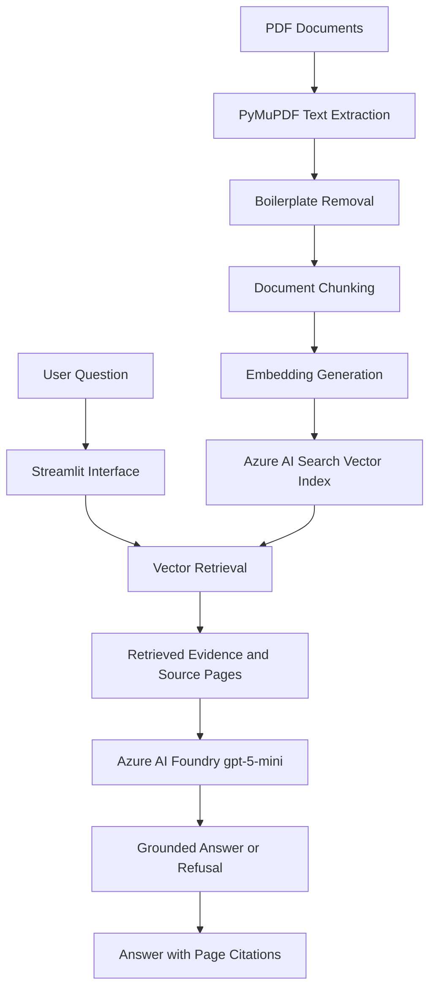
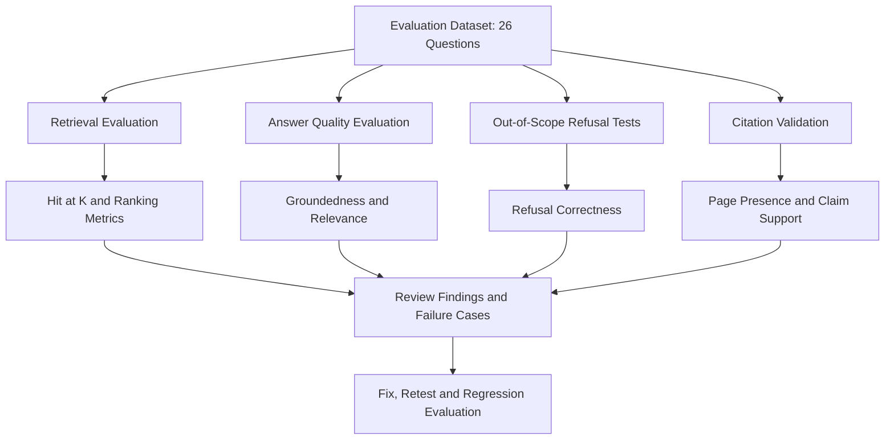
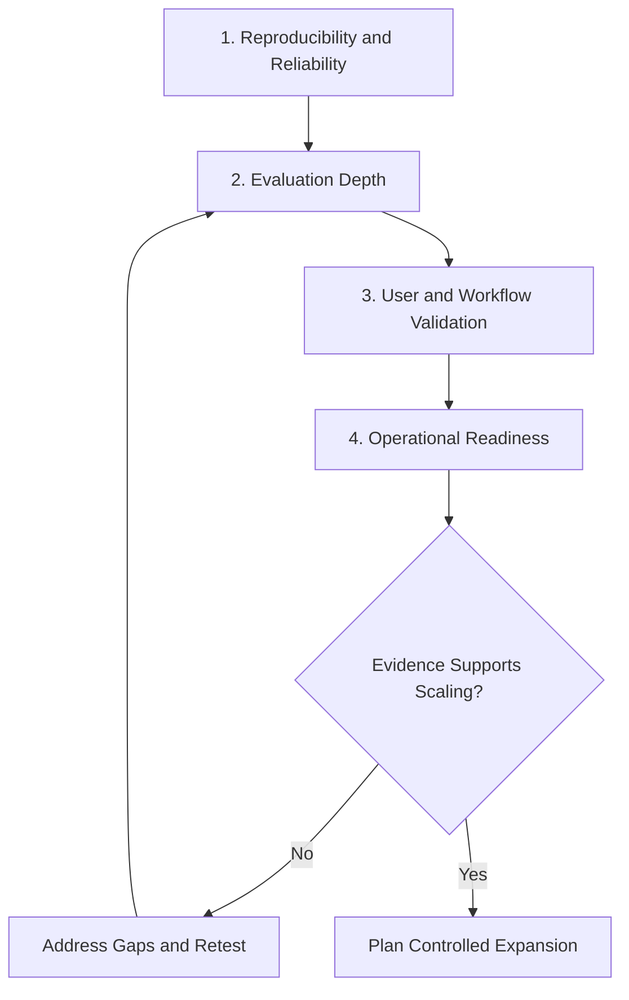

# DOCMIND — Enterprise RAG Knowledge Assistant

**An AI-powered document knowledge assistant built with Azure AI, designed to answer questions from PDFs with grounded responses and page-level source citations.**

DOCMIND explores how knowledge workers can find and verify information in PDF documents without manually searching through every page. The product emphasizes answer quality, retrieval relevance, traceable evidence, appropriate refusal, and repeatable evaluation.

> **Evidence boundary:** The metrics below come from saved prototype evaluation artifacts. They are not production benchmarks and do not establish production adoption, realized ROI, latency at scale, or user-time savings.

## 1. Product Overview

| **Area**               | **Description**                                                                                                           |
| ---------------------- | ------------------------------------------------------------------------------------------------------------------------- |
| User problem           | Finding and verifying facts in PDF documentation can require manual searching and interpretation.                         |
| Target-user hypothesis | Knowledge workers, analysts, and professionals who repeatedly look up information in PDFs.                                |
| Product concept        | Ask questions in natural language and receive answers grounded in retrieved document passages, with page-level citations. |
| Primary trust features | Grounded responses, traceable source pages, out-of-scope refusal, and automated quality checks.                           |
| User interface         | Streamlit                                                                                                                 |
| Core services          | Azure AI Foundry and Azure AI Search                                                                                      |

## 2. Problem Statement and Value Hypothesis

### Problem statement

People consulting PDF documents may need to manually search, compare, and interpret passages. A generative answer is difficult to trust when users cannot trace it back to the source material.

DOCMIND retrieves relevant document chunks, generates answers from retrieved evidence, and surfaces page-level citations so users can inspect the supporting pages.

### Job to be done

> When I need an answer from a document set, help me find the relevant passage and summarize it with enough source evidence that I can verify it quickly.

### Value hypothesis

If users can ask questions in natural language and receive grounded answers with page-level citations, the time needed to locate information and verify an answer may decrease without increasing unsupported-answer risk.

This remains a **hypothesis**. User-time savings, adoption, satisfaction, and business ROI have not been established by the available evaluation evidence.

Discovery still required:

- Interview intended users.
- Identify document types and query frequency.
- Observe the existing document-search workflow.
- Measure time spent finding and verifying information.
- Quantify error and rework costs.

## 3. Architecture and Request Flow

DOCMIND processes PDF documents, retrieves relevant evidence, and generates grounded answers with page-level citations.



### Architecture components

| **Layer**  | **Implementation**                                                                                                                                          |
| ---------- | ----------------------------------------------------------------------------------------------------------------------------------------------------------- |
| Ingestion  | PyMuPDF extracts PDF text. Repeated headers and footers are detected and removed when they recur across 50% or more of pages, as documented in the project. |
| Embeddings | Azure AI Foundry deployment of `text-embedding-3-small`.                                                                                                    |
| Retrieval  | Azure AI Search vector index with HNSW similarity search.                                                                                                   |
| Generation | Azure AI Foundry deployment of `gpt-5-mini` generates answers grounded in retrieved context.                                                                |
| Experience | Streamlit provides the question-answering interface and source-page citations.                                                                              |
| Evaluation | Saved question and gold sets plus scripts check retrieval, groundedness, relevance, expected-fact coverage, refusal and citation behavior.                  |

## 4. Key Product Capabilities

- **PDF ingestion:** Extract document text and prepare it for retrieval.
- **Boilerplate removal:** Detect recurring headers and footers that can pollute retrieval chunks.
- **Vector retrieval:** Find relevant document passages for a user question.
- **Grounded generation:** Instruct the model to answer from retrieved context rather than unsupported knowledge.
- **Page-level citations:** Provide source-page references to help users verify answers.
- **Out-of-scope handling:** Test whether the assistant refuses questions that cannot be answered from available document evidence.
- **Automated evaluation:** Evaluate retrieval and answer behavior against a saved test set.

## 5. Evaluation Results

The saved full evaluation covers **26 questions: 22 answerable questions and 4 intentionally unanswerable questions**.

| **Metric**                  | **Saved result**           | **Interpretation**                                                                |
| --------------------------- | -------------------------- | --------------------------------------------------------------------------------- |
| Full evaluation set         | 26 questions               | 22 answerable questions and 4 out-of-scope traps                                  |
| Groundedness                | 26/26 passed               | LLM-judge result on this test set; not an independent guarantee of truth          |
| Relevance                   | 26/26 passed               | LLM-judge result on this test set                                                 |
| Retrieval Hit\@1            | 22/22 answerable questions | All answerable questions had a relevant result at rank 1 in the saved full report |
| Retrieval Hit\@3            | 22/22 answerable questions | All answerable questions had a relevant result within the top 3                   |
| Retrieval Hit\@5            | 22/22 answerable questions | All answerable questions had a relevant result within the top 5                   |
| Expected-fact coverage      | 52/52                      | All expected facts were reported as covered                                       |
| Correct trap refusals       | 4/4                        | All four unanswerable questions were correctly refused                            |
| Cited pages retrieved       | 26/26                      | Every cited page was present in the retrieved context                             |
| Citation-support judgment   | 25/26                      | One citation-support judgment did not pass                                        |
| Evaluation execution errors | 0                          | No execution errors recorded in the saved run                                     |

### Evaluation and quality-control flow



### How to interpret these results

These are saved prototype evaluation results, not a universal benchmark or production guarantee.

LLM-as-judge outputs require human scrutiny. Citation-page presence and citation correctness are separate quality dimensions: retrieving a page does not automatically prove that the cited page supports the answer claim.

### Retrieval experiments and decisions

A separate **22-question retrieval experiment** recorded the following results:

| **Approach**                  | **Saved evidence**                             | **Product decision**                                                 |
| ----------------------------- | ---------------------------------------------- | -------------------------------------------------------------------- |
| Vector-only baseline          | Hit\@1 90.9%, Hit\@3 100%, MRR 0.947           | Retain as the baseline                                               |
| Hybrid search                 | Hit\@1 86.4%, MRR 0.932 in the same comparison | No aggregate improvement demonstrated                                |
| Full query rewriting          | Aggregate metrics matched the baseline         | No overall improvement demonstrated                                  |
| Targeted retrieval experiment | Hit\@1 100% across 20 questions                | Promising, but not directly comparable with the 22-question baseline |

The separate retrieval experiment and the 26-question full evaluation use different evaluation contexts. Their figures are intentionally reported separately rather than silently reconciled into one result.

## 6. Product Decisions and Trade-offs

1. **Keep the MVP focused.** Start with a clear document-grounded question-answering flow rather than expanding prematurely into a broad enterprise platform.
2. **Treat citations as a trust feature.** Measure whether source pages are present separately from whether they support the associated claims.
3. **Test refusal behavior explicitly.** Include out-of-scope questions to detect unsupported answers.
4. **Retain vector-only retrieval as the baseline.** The recorded comparisons did not show aggregate improvement from hybrid search or full query rewriting.
5. **Defer platform expansion.** SaaS features, tenant management, billing and production scaling should wait until the MVP is stable and user value is validated.
6. **Review judge outputs.** Automated evaluation makes quality checks repeatable, but LLM-as-judge results should be sampled and manually inspected.

## 7. Risks and Known Limitations

- **One citation-support miss remains** in the saved full evaluation.
- LLM judges may produce false positives or attribution errors.
- A clean-environment installation and full end-to-end rebuild were not completed in the reviewed readiness work.
- Latency, p95 response time, cost per query, concurrency, uptime, user satisfaction, adoption and ROI are not established.
- Results have not established generalization to larger or more representative document collections.
- The saved evaluation describes an existing run; it should not be represented as a fresh rerun.

## 8. Roadmap: Evidence Before Scale

The roadmap prioritizes reliable evidence and validated user value before broader deployment.



### Priority 1 — Reliability and reproducibility

- Reproduce the environment from setup instructions in a clean environment.
- Complete a full end-to-end rebuild.
- Inspect the citation-support failure and verify any fix with a targeted evaluation.

### Priority 2 — Evaluation depth

- Expand the evaluation set with representative answerable, ambiguous and unanswerable questions.
- Manually review a sample of groundedness, relevance, refusal and citation judgments.
- Preserve separate datasets, metric definitions and provenance for each experiment.
- Add regression checks for known failure modes.

### Priority 3 — User and workflow validation

- Interview intended users and observe their current document-search workflow.
- Measure a baseline for time to find information, verification effort and error/rework.
- Test the prototype with a defined user group.
- Collect feedback on trust, usefulness and answer verification.

### Priority 4 — Operational readiness

- Measure latency, p95 response time, cost per query, reliability and failure behavior.
- Add appropriate monitoring and operational ownership before broader deployment.
- Revisit architecture and scale only when evaluation and user evidence justify the investment.

## 9. Technology Stack

- **Language:** Python
- **LLM and embeddings:** Azure AI Foundry `gpt-5-mini`, `text-embedding-3-small`
- **Retrieval:** Azure AI Search vector index with HNSW similarity search
- **PDF processing:** PyMuPDF
- **User interface:** Streamlit
- **Evaluation:** Saved evaluation sets and scripts for retrieval and answer-quality checks

## 10. Run Locally

### Step 1 — Clone the repository and create a virtual environment

```bash
git clone https://github.com/tamilarasan-ml/docmind-rag.git
cd docmind-rag
python -m venv venv
```

On Windows:

```powershell
venv\Scripts\activate
pip install -r requirements.txt
```

### Step 2 — Configure Azure credentials

Create a local `.env` file using `.env.example` as a reference. Configure the required Azure AI and Azure AI Search endpoint, key, deployment, API-version and index settings.

**Never commit credentials or secrets.**

### Step 3 — Run the ingestion and indexing pipeline

Run the project scripts in this order:

```bash
python src/ingest.py
python src/embed.py
python src/setup_index.py
python src/upload.py
```

### Step 4 — Launch the application

```bash
streamlit run src/app.py
```

Refer to the repository files and `.env.example` for the current configuration details.

## 11. Project Structure

```text
docmind-rag/
├── data/
│   ├── eval_gold.json
│   ├── eval_questions.json
│   ├── eval_report.json
│   ├── chunks.json
│   └── chunks_with_embeddings.json
├── src/
│   ├── ingest.py
│   ├── embed.py
│   ├── setup_index.py
│   ├── upload.py
│   ├── chat.py
│   ├── app.py
│   ├── citation_utils.py
│   ├── evaluate.py
│   ├── retrieval_eval.py
│   ├── query_rewrite_eval.py
│   └── additional evaluation and validation scripts
├── tests/
│   └── test_citation_utils.py
├── requirements.txt
├── README.md
└── .env.example
```


## 12. What DOCMIND Demonstrates as an AI Product Case Study

- **Problem framing:** A concrete document-search and answer-verification workflow.
- **Value hypothesis:** A testable expectation around finding and verifying information more efficiently.
- **MVP definition:** Grounded answers, page-level citations and out-of-scope handling.
- **Technical feasibility:** An Azure-based ingestion, retrieval and generation pipeline.
- **Evaluation discipline:** Explicit test sets, retrieval experiments and answer-quality checks.
- **Product judgment:** Retaining a baseline when alternatives have not demonstrated aggregate improvement.
- **Responsible AI:** Acknowledging citation failures, reviewing automated judges and avoiding unsupported business-impact claims.

## Current Status

DOCMIND has a working prototype flow and saved evaluation artifacts described above. The next milestone is to improve reproducibility, resolve the citation-support issue, expand representative evaluation and validate user value before making production-readiness or ROI claims.

---

**Author:** Tamilarasan Valarmathinathan\
**GitHub:** [tamilarasan-ml](https://github.com/tamilarasan-ml)\
**Repository:** [docmind-rag](https://github.com/tamilarasan-ml/docmind-rag)
